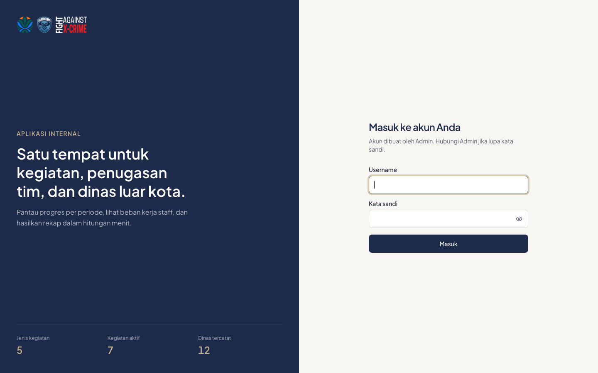

# 1. Masuk dan akun

## Masuk

1. Buka alamat SIMKEG yang diberikan Admin.
2. Isi **Username** dan **Kata sandi**, lalu klik **Masuk**.
3. Klik ikon mata di kolom kata sandi untuk menampilkan atau menyembunyikan sandi.

## Hal yang perlu diketahui

- **Tidak ada pendaftaran mandiri.** Akun hanya dibuat oleh Admin.
- **Lupa kata sandi?** Hubungi Admin untuk direset. Tidak ada reset lewat email.
- **Salah sandi 5 kali** membuat login dikunci sementara (sekitar 1 menit).
- **Akun nonaktif** tidak bisa masuk. Kalau akun Anda dinonaktifkan saat sedang dipakai, Anda langsung keluar pada klik berikutnya.
- Setelah Admin mereset sandi Anda, Anda keluar dari semua perangkat dan perlu masuk lagi dengan sandi baru.

## Keluar

Klik nama Anda di pojok kanan atas, lalu **Keluar**.

---
[Daftar isi](README.md) · Berikutnya: [Dashboard](02-dashboard.md)
