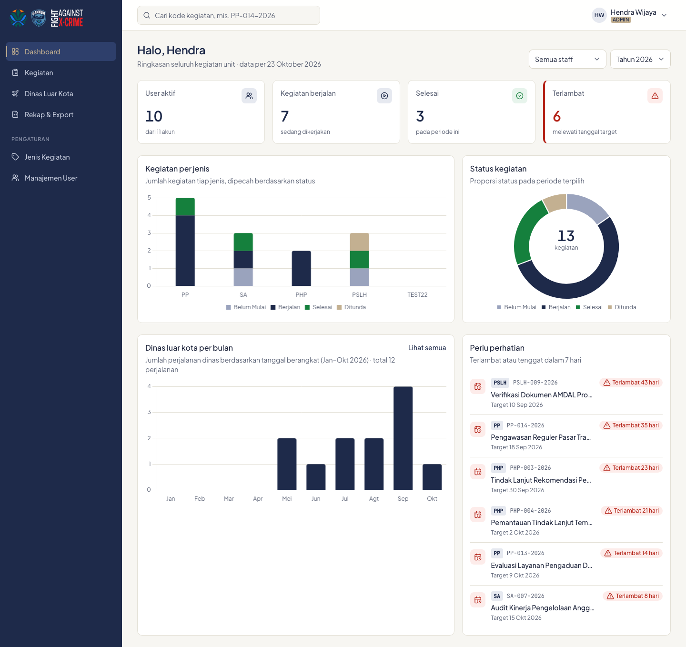

# 2. Dashboard

Dashboard adalah halaman pertama setelah masuk. Isinya ringkasan sesuai hak akses: Admin melihat seluruh unit, Staff hanya kegiatan timnya.

## Filter

- **Tahun**: menampilkan kegiatan yang periodenya jatuh di tahun tersebut.
- **Staff** (khusus Admin): menampilkan data satu staff saja, untuk melihat beban kerjanya.

## Kartu ringkasan

| Kartu | Arti |
|---|---|
| User aktif (Admin) / Kegiatan tim (Staff) | Jumlah akun aktif, atau jumlah kegiatan tim Anda pada periode ini |
| Kegiatan berjalan | Kegiatan berstatus Berjalan |
| Selesai | Kegiatan berstatus Selesai |
| Terlambat | Kegiatan yang belum Selesai dan sudah melewati tanggal target |

Klik kartu Berjalan, Selesai, atau Terlambat untuk membuka daftar kegiatan yang sudah terfilter.

## Grafik dan daftar

- **Kegiatan per jenis**: jumlah kegiatan tiap jenis, dipecah per status.
- **Status kegiatan**: proporsi status pada periode terpilih.
- **Dinas luar kota per bulan**: jumlah perjalanan berdasarkan tanggal berangkat.
- **Perlu perhatian**: kegiatan yang terlambat atau tenggatnya tinggal 7 hari. Klik untuk membuka detailnya.

---
[Daftar isi](README.md) · Sebelumnya: [Masuk dan akun](01-masuk-dan-akun.md) · Berikutnya: [Kegiatan](03-kegiatan.md)
