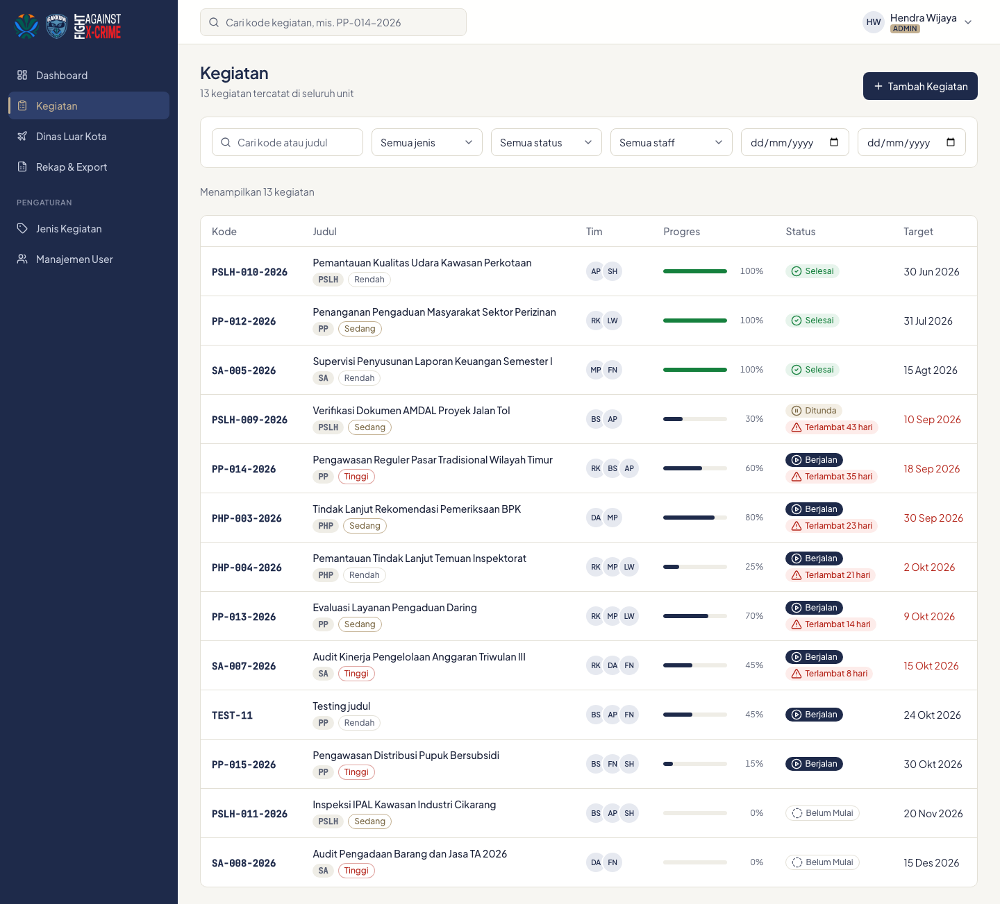
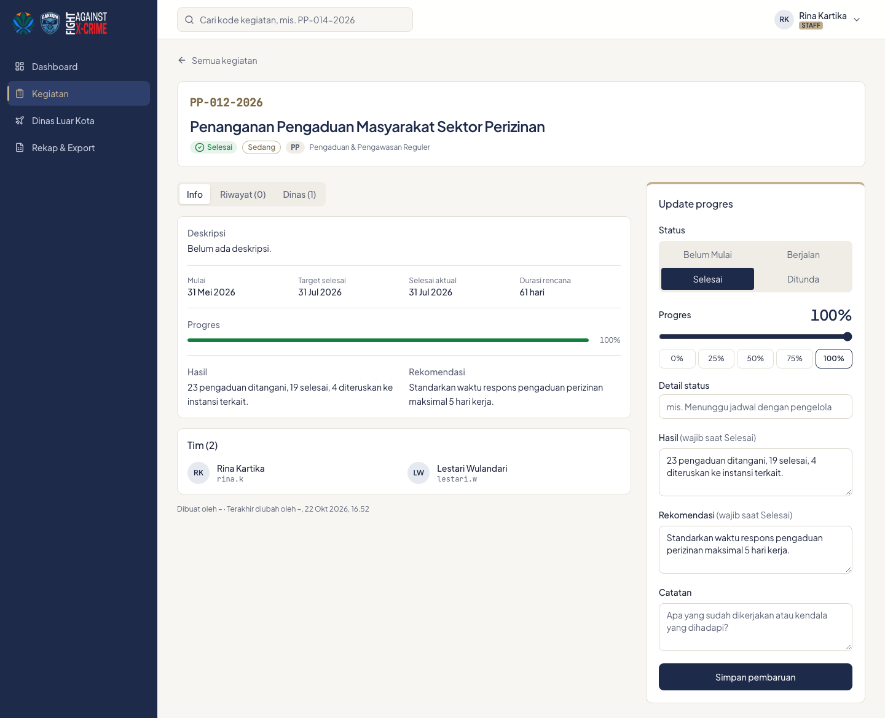
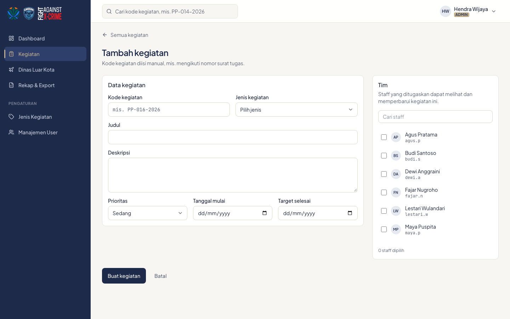

# 3. Kegiatan

## Daftar kegiatan

Menu **Kegiatan** menampilkan semua kegiatan yang boleh Anda lihat.

- **Cari** kode atau judul. Kotak cari di bagian atas setiap halaman juga bisa dipakai: kalau kode yang diketik persis cocok, detail kegiatannya langsung terbuka.
- **Filter**: jenis, status, staff, dan rentang tanggal. Klik **Reset filter** untuk mengosongkan semuanya.
- Klik **kode** atau **judul** untuk membuka detail.
- Badge merah **Terlambat N hari** muncul otomatis bila kegiatan belum Selesai dan sudah lewat tanggal target. Terlambat bukan status tersendiri.

## Detail kegiatan

Detail kegiatan punya tiga tab:

- **Info**: deskripsi, tanggal, progres, hasil, rekomendasi, catatan terakhir, dan anggota tim.
- **Riwayat**: semua perubahan status, progres, detail status, catatan, hasil, dan rekomendasi. Tercatat siapa yang mengubah dan kapan.
- **Dinas**: perjalanan dinas luar kota yang terkait kegiatan ini.

### Memperbarui progres (Staff tim dan Admin)

Panel **Update progres** di sebelah kanan dipakai untuk melaporkan perkembangan:

1. Pilih **Status**: Belum Mulai, Berjalan, Selesai, atau Ditunda.
2. Atur **Progres** dengan slider atau tombol cepat 0/25/50/75/100%.
3. Isi **Detail status** bila perlu, mis. "Menunggu jadwal dengan pengelola".
4. Isi **Hasil** dan **Rekomendasi**. Keduanya boleh diisi kapan saja, dan **wajib diisi saat status diubah ke Selesai**.
5. Tulis **Catatan** tentang apa yang sudah dikerjakan atau kendala yang dihadapi. Kolom ini kosong lagi setelah disimpan; isinya tampil sebagai "Catatan terakhir" dan masuk riwayat.
6. Klik **Simpan pembaruan**.

Saat status diubah ke Selesai, tanggal selesai aktual terisi otomatis dengan tanggal hari itu.

## Menambah dan mengubah kegiatan (Admin)

1. Di daftar kegiatan, klik **Tambah Kegiatan**.
2. Isi **Kode kegiatan** secara manual, mis. mengikuti nomor surat tugas. Kode wajib unik dan boleh memuat garis miring, mis. `001/ST/2026`.
3. Pilih **Jenis**, isi **Judul**, **Deskripsi**, **Prioritas**, **Tanggal mulai**, dan **Target selesai**.
4. Centang staff di panel **Tim**. Hanya anggota tim yang bisa melihat dan memperbarui kegiatan ini.
5. Klik **Buat kegiatan**.

Untuk mengubah data utama atau tim, buka detail kegiatan lalu klik **Edit**. Status dan progres tidak diubah di form ini, melainkan di panel Update progres.

**Menghapus**: buka detail, klik **Hapus**. Kegiatan yang masih punya data dinas luar kota tidak bisa dihapus; hapus dulu data dinasnya.

---
[Daftar isi](README.md) · Sebelumnya: [Dashboard](02-dashboard.md) · Berikutnya: [Dinas luar kota](04-dinas-luar-kota.md)
