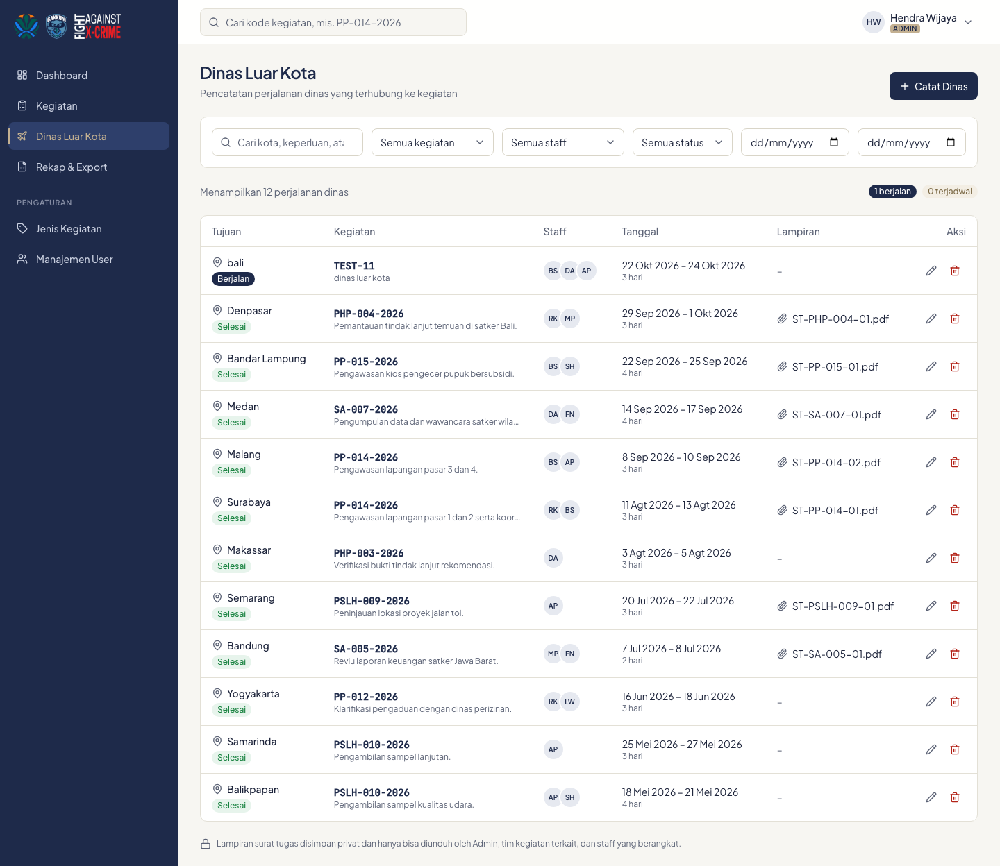

# 4. Dinas luar kota

Setiap perjalanan dinas terhubung ke satu kegiatan. Data dicatat oleh Admin dan langsung final; tidak ada alur persetujuan.

## Siapa bisa melihat

- **Admin**: semua dinas.
- **Staff**: dinas dari kegiatan yang timnya ia ikuti, **dan** dinas yang ia ikuti sendiri walaupun bukan anggota tim kegiatannya. Pada kasus kedua, detail kegiatannya tetap tidak bisa dibuka.

## Daftar dan detail

- **Cari** kota, keperluan, atau kode kegiatan.
- **Filter**: kegiatan, staff, status, dan rentang tanggal.
- **Status** dihitung otomatis dari tanggal: *Terjadwal* (belum berangkat), *Berjalan* (sedang berlangsung), *Selesai* (sudah kembali).
- Klik nama kota untuk membuka detail: kegiatan terkait, keperluan, staff yang berangkat, dan lampiran.

## Lampiran surat tugas

Lampiran disimpan privat. File hanya bisa diunduh oleh Admin, anggota tim kegiatan terkait, dan staff yang berangkat. Link unduhan tidak bisa dibuka tanpa masuk.

## Mencatat dinas (Admin)

1. Klik **Catat Dinas** di halaman daftar, atau **Catat dinas** di tab Dinas pada detail kegiatan (kegiatannya langsung terisi).
2. Pilih **Kegiatan**, isi **Kota tujuan**, **Tanggal berangkat**, **Tanggal kembali**, dan **Keperluan**.
3. Centang **Staff yang berangkat**, minimal satu. Anggota tim kegiatan ditandai "Tim".
4. Unggah **Lampiran surat tugas** bila ada: PDF, JPG, atau PNG, maksimal 5 MB.
5. Klik **Catat dinas**.

Untuk mengubah atau menghapus, pakai ikon pensil atau tempat sampah di daftar, atau tombol **Edit** / **Hapus** di detail. Saat lampiran diganti atau dinas dihapus, file lampiran lamanya ikut dihapus.

---
[Daftar isi](README.md) · Sebelumnya: [Kegiatan](03-kegiatan.md) · Berikutnya: [Rekap dan export](05-rekap-dan-export.md)
