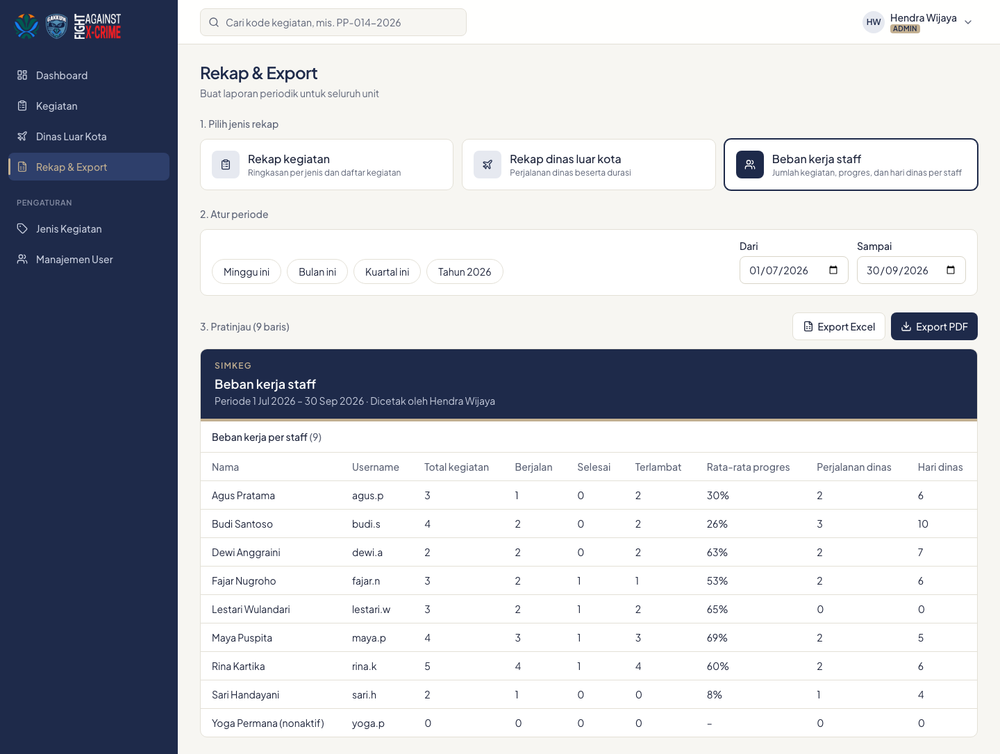

# 5. Rekap dan export

Menu **Rekap & Export** membuat laporan periodik. Admin merekap seluruh unit; Staff merekap data timnya.

## Langkah

1. **Pilih jenis rekap**:
   - **Rekap kegiatan**: ringkasan per jenis (total, per status, terlambat, rata-rata progres) dan daftar kegiatan lengkap, termasuk tim, hasil, dan rekomendasi.
   - **Rekap dinas luar kota**: tanggal, durasi, kota, kegiatan, staff, keperluan, status, dan ada/tidaknya lampiran.
   - **Beban kerja staff**: per staff, jumlah kegiatan, berjalan, selesai, terlambat, rata-rata progres, jumlah perjalanan, dan hari dinas.
2. **Atur periode** dengan tombol cepat (Minggu ini, Bulan ini, Kuartal ini, Tahun ini) atau isi tanggal **Dari** dan **Sampai**.
3. Periksa **Pratinjau**, lalu klik **Export Excel** atau **Export PDF**.

Pratinjau, Excel, dan PDF selalu berisi data yang sama.

## Cara periode dihitung

- **Kegiatan** masuk rekap bila rentang tanggal mulai sampai target selesai bersinggungan dengan periode.
- **Dinas** masuk rekap bila perjalanannya bersinggungan dengan periode, dan dihitung dengan durasi penuh. Contoh: dinas 30 Sep–2 Okt tetap terhitung 3 hari di rekap September.

## Format file

- **Excel**: satu sheet per tabel. Rekap kegiatan punya dua sheet: *Ringkasan per jenis* dan *Daftar kegiatan*.
- **PDF**: A4 landscape, dengan periode, nama pencetak, dan waktu cetak di kop.

---
[Daftar isi](README.md) · Sebelumnya: [Dinas luar kota](04-dinas-luar-kota.md) · Berikutnya: [Admin: jenis kegiatan dan user](06-admin-jenis-kegiatan-dan-user.md)
