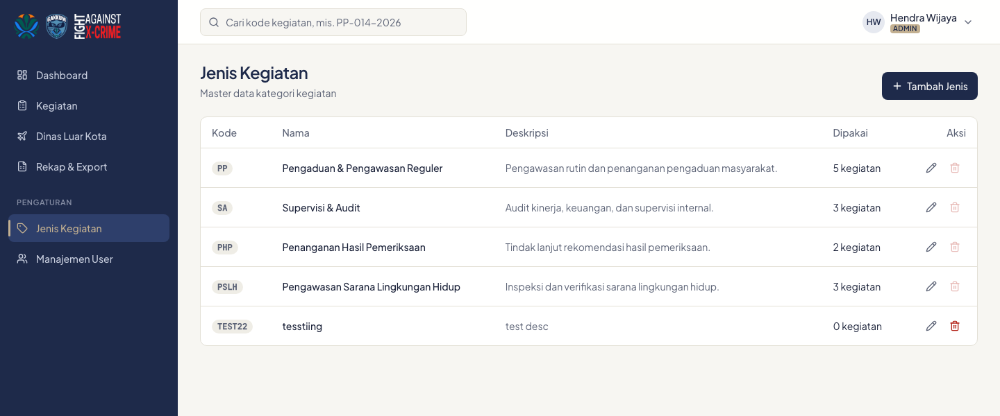
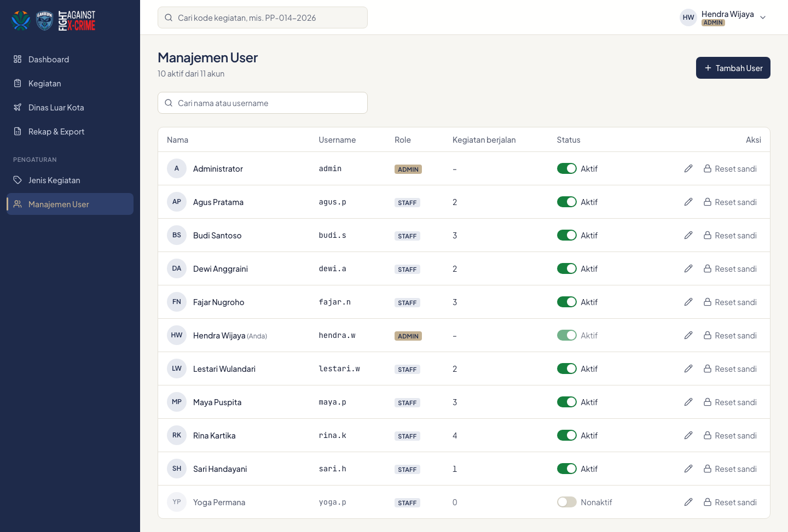

# 6. Admin: jenis kegiatan dan manajemen user

Kedua menu ini ada di bagian **Pengaturan** pada sidebar dan hanya terlihat oleh Admin.

## Jenis kegiatan

Jenis kegiatan adalah master data kategori, mis. PP, SA, PHP, PSLH.

- **Tambah Jenis**: isi kode, nama, dan deskripsi (opsional). Kode otomatis huruf besar, wajib unik, hanya huruf dan angka tanpa spasi.
- **Edit**: klik ikon pensil.
- **Hapus**: hanya bisa untuk jenis yang belum dipakai kegiatan apa pun.
- Klik angka di kolom **Dipakai** untuk melihat kegiatan dengan jenis tersebut.

## Manajemen user

### Membuat akun

1. Klik **Tambah User**.
2. Isi **Nama**, **Username** (huruf kecil, angka, titik, garis bawah, atau strip), **Role** (Admin/Staff), dan **Kata sandi awal** (minimal 8 karakter).
3. Klik **Buat akun**, lalu sampaikan username dan sandi ke yang bersangkutan.

### Mengubah data dan role

Klik ikon pensil untuk mengubah nama, username, atau role.

### Mengaktifkan dan menonaktifkan

Klik tombol di kolom **Status**. Akun yang dinonaktifkan:

- langsung keluar dari semua perangkat dan tidak bisa masuk lagi;
- tetap tercatat di riwayat: keanggotaan tim, dinas, dan perubahan yang pernah ia buat tidak hilang.

### Reset sandi

1. Klik **Reset sandi** pada baris user.
2. Ketik sandi baru, atau klik **Buat acak** untuk sandi 10 karakter yang mudah dibacakan.
3. Klik **Simpan sandi** dan sampaikan sandi baru ke yang bersangkutan. Ia akan keluar dari semua perangkat.

### Pengaman

- Admin tidak bisa menonaktifkan atau menurunkan role akunnya sendiri.
- Harus selalu ada minimal satu Admin aktif.

---
[Daftar isi](README.md) · Sebelumnya: [Rekap dan export](05-rekap-dan-export.md)
